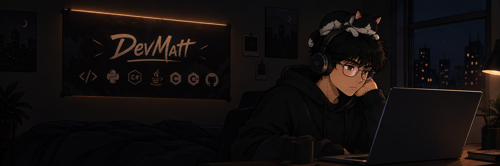

---

## 👤 Sobre mí

Soy **Matías Santiago Muñoz**, desarrollador de software y videojuegos de Salta, Argentina, con más de 8 años de experiencia formativa en tecnología y lógica computacional.

Me especializo en la **resolución lógica de problemas** y el desarrollo de soluciones que respondan a **necesidades reales de las personas** — mi filosofía: un buen programa no solo funciona, *hace la vida más fácil a quien lo usa*.

Aprovecho la **IA generativa** como multiplicador de productividad: de la idea al código de forma más rápida y eficaz. Actualmente documento mi aprendizaje y cursos aquí en GitHub.

---

## 🛠️ Tecnologías y herramientas

| Área | Stack |
|------|-------|
| **Desktop (Python)** |    |
| **Datos y Backend** |     |
| **Videojuegos** |     |
| **Bajo nivel y robótica** |     |

---

## 🎯 Proyecto destacado: Sistema POS (Punto de Venta)

Sistema de gestión comercial de escritorio con **base de datos local**, desarrollado en Python (2022 — actualidad):

- 🖥️ Gestión de productos, historial de ventas y control de stock con **PyQt5**
- 🗄️ Persistencia local con **SQLite**
- 📄 Reportes y tickets en **PDF**
- 📷 Lectura de **códigos de barras** para agilizar el checkout

---

## 🚀 En qué estoy trabajando ahora

- 🧱 Fortalecer mis **bases de programación**: algoritmos, estructuras de datos y buenas prácticas
- 📚 **Cursos y aprendizaje documentado en GitHub**
- 🎮 Proyectos de videojuegos en **Godot** (Game Jams y personales)
- 🤖 **IA generativa** aplicada al flujo de desarrollo

---

## 📫 Contacto

---

---

*Matías Santiago Muñoz — DevMatt24 · Salta, Argentina · © 2026*
